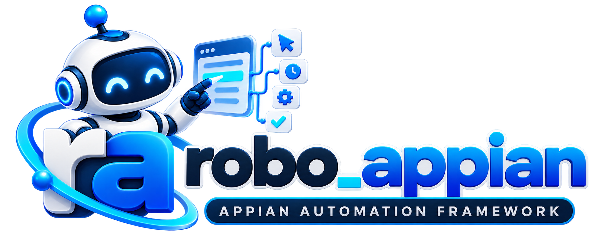

  <section class="ra-target-hero">
    

      

        ◉ Test Automation
        Python Automation Framework for Appian
      

      <h1>Automate Appian. <em>Faster. Reliably.</em></h1>
      
A business-readable Python library for automating Appian workflows. Write automation using the labels, buttons, fields, tables, and dialogs a user sees; the framework handles the browser and Appian synchronization behind the scenes.

      

        <a class="ra-target-btn primary" href="getting-started/quick-start/">🚀&nbsp; Start a Business Flow →</a>
        <a class="ra-target-btn" href="features/">◉&nbsp; Explore Features →</a>
      

      
Poetry<code>poetry add robo-appian</code>

    

    

      
      
<b>▶</b>Automate Workflows

      
<b>✓</b>Test Processes

      
<b>▥</b>Ensure Quality

      
<b>⚙</b>Reusable Utilities

      
<b>▥</b>Pytest Ready

      
<b>∞</b>CI/CD Friendly

      
<b>▥</b>Scalable

    

  </section>

  <section class="ra-target-features" aria-label="robo-appian framework capabilities">
    <article>◇
<strong>Reusable Utilities</strong>
Common Appian actions, components, and helpers ready to use.

</article>
    <article>◎
<strong>Readable Controls</strong>
Choose Appian controls using their visible labels.

</article>
    <article>▤
<strong>Pytest Ready</strong>
Run selected tests and check the expected outcomes.

</article>
    <article>ϟ
<strong>Parallel Friendly</strong>
Designed to work with isolated workers and parallel execution.

</article>
    <article>∞
<strong>CI/CD Friendly</strong>
Fits Jenkins and modern CI/CD automation pipelines.

</article>
    <article>▥
<strong>Clear Diagnostics</strong>
Framework behavior works with logs, screenshots, and reports.

</article>
  </section>

  <section class="ra-target-workbench">
    

Start with a small workflow
<ol><li>Choose a task and approved test data.</li><li>Prepare the starting page and browser.</li><li>Perform supported interactions.</li><li>Check the expected business outcome.</li><li>Review the result and available evidence.</li></ol>

    

Make each run reviewable

Use a visible browser while checking a new test. Enable evidence when needed, and review the failed step together with its expected result.

  </section>

  <section class="ra-target-docs">
    
<h2>▣ &nbsp; Documentation</h2><a href="getting-started/installation/">Explore all docs&nbsp; →</a>

    

      <a href="getting-started/quick-start/">▶
<strong>Write a Business Flow</strong><small>Turn business steps into readable Appian automation.</small>
<b>→</b></a>
      <a href="guides/components/">⚙
<strong>Choose Components</strong><small>Learn the few concepts needed to write readable Appian tests.</small>
<b>→</b></a>
      <a href="features/">&lt;/&gt;
<strong>Available Features</strong><small>Explore the supported actions and checks.</small>
<b>→</b></a>
      <a href="getting-started/quick-start/">▧
<strong>Examples</strong><small>Follow the steps for a first workflow.</small>
<b>→</b></a>
      <a href="guides/components/">●
<strong>Best Practices</strong><small>Choose the right component for the control.</small>
<b>→</b></a>
      <a href="getting-started/troubleshooting/">◉
<strong>Troubleshooting</strong><small>Common issues and practical solutions.</small>
<b>→</b></a>
    

  </section>

